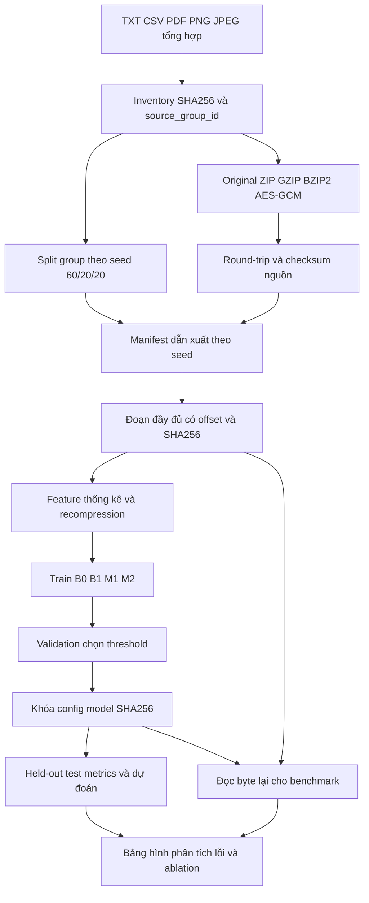

# Kiến trúc nguyên mẫu

Tag/nonce/AAD/key AES nằm ngoài byte input classifier. Metadata nguồn/dẫn xuất chỉ dùng join, chia dữ liệu và phân tích subgroup; `matrix` chỉ nhận allowlist feature. Original không nối vào negative class. Không có process monitoring hoặc nhánh phản ứng tự động.

CSV tác giả có pipeline riêng: ZIP→parse chín feature→10-fold row CV→kết quả tham khảo. Nó không nối vào train/validation/test của corpus kiểm soát hoặc benchmark đọc byte.
